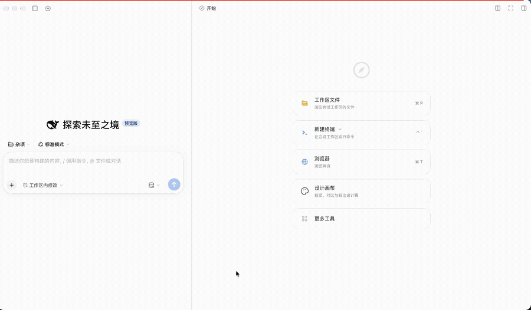
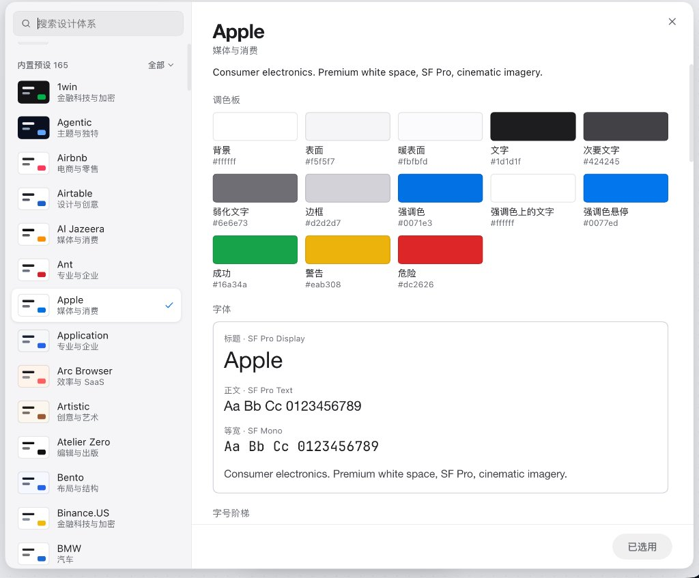
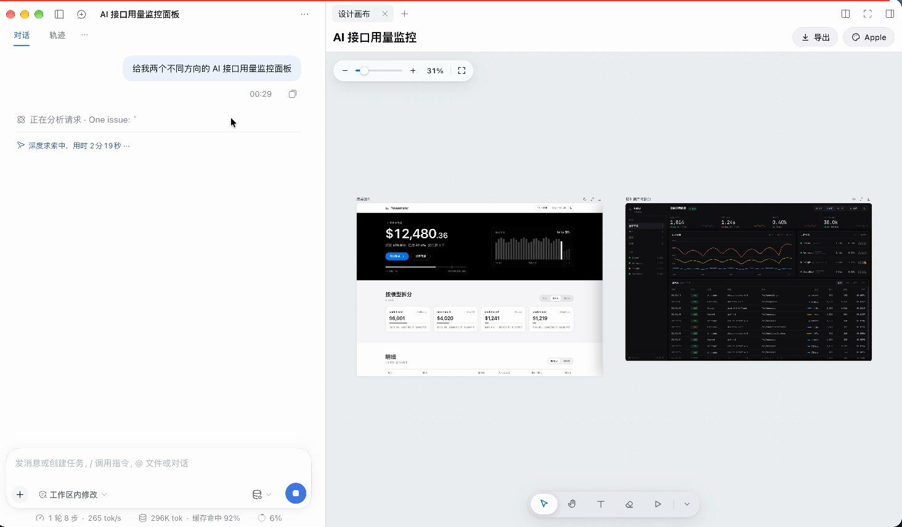
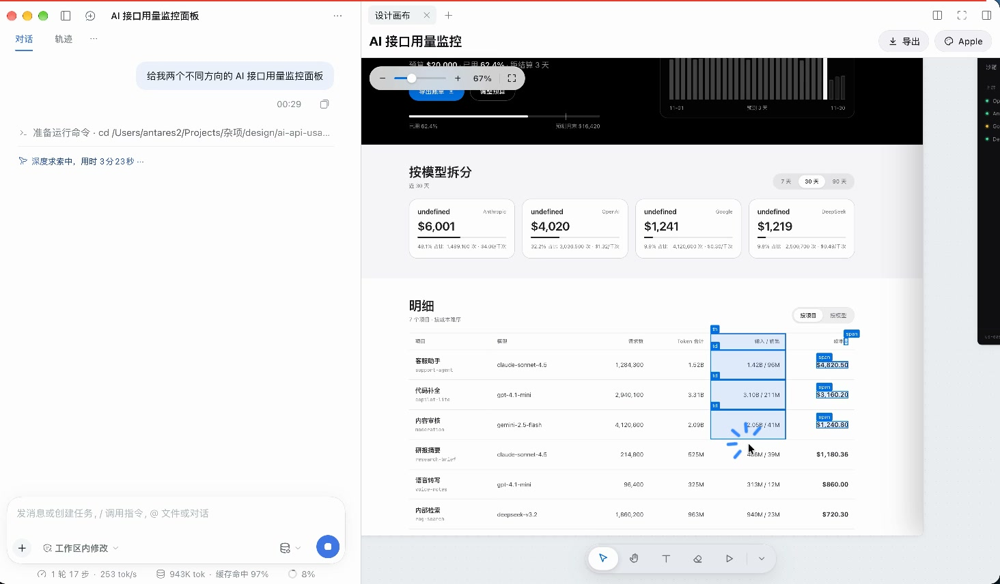

# dsh-design-board

[](https://github.com/Antares422/dsh-design-board/actions/workflows/ci.yml)
[](https://www.npmjs.com/package/dsh-design-board)
[](LICENSE)
[](https://github.com/deepseek-ai/deepseek-harness)

[中文](README.md) | English

**Give DeepSeek Harness a built-in design canvas.**

Pick a style from 165 built-in design systems, describe what you need, and an interactive page opens right in the sidebar canvas. Refine a single direction or compare multiple options side by side; when something feels off, click or marquee-select the element directly on the canvas with a quick note — no browser tab juggling, no annotated screenshots.



## Features

- **165 Built-in Design Systems**: Includes Apple, Linear, Airbnb, Stripe, Notion, Vercel, and more, each with full design specs, CSS tokens, and reference components. Pick a style from the top-right drawer and the agent builds directly to that spec; defaults to Apple style when unspecified.
- **Side-by-Side Infinite Canvas**: Renders agent-generated interactive HTML prototypes live in the right sidebar with zoom slider, keyboard zoom, multi-page tabs, and full-screen view.
- **Direct DOM Picking & Notes**: Click or marquee-select elements inside any frame and drop text notes. Exact CSS selectors and annotations are injected automatically on the next turn so the agent updates the frame in place.
- **Live Play Mode & Theme Toggle**: Switch to Play mode to interact with controls directly, and toggle light or dark theme per frame.
- **Quality Checks & Session Isolation**: Automatically checks interactivity, light/dark themes, and runtime errors with silent in-place fixes. Each session uses its own isolated `design/<sessionId>/` directory.
- **Export**: Export single frames or full pages to PNG, multi-page PDF, or a standalone HTML gallery.

## Screenshots

### 165 Built-in Design Systems


### Side-by-Side Comparison


### Visual DOM Picking & Marquee Selection


## Install

### Inside DSH

Open **Plugins -> Add plugin**, enter:

```text
dsh-design-board
```

Or send this message in chat:

```text
Install this plugin for me: https://github.com/Antares422/dsh-design-board
```

### Via CLI

```bash
# From npm
dsh plugin --profile web add dsh-design-board

# From GitHub
dsh plugin --profile web add "github:Antares422/dsh-design-board"
```

On DSH Desktop, install through **Plugins -> Add plugin** inside the app so it targets the desktop profile. Prebuilt `index.js` and `client.js` are included; no build step required.

## Usage

- *"Give me two different visual directions for an AI API usage dashboard."*
- *"Design an API quota dashboard in Linear style."*
- Choose any style from the top-right **Design System** drawer, then say: *"Create another direction using the selected style."*
- Click or marquee-select elements on the canvas, then say: *"Update based on my selections and notes."*

## Shortcuts

| Key | Action |
| --- | --- |
| `V` | Select or marquee-select elements |
| `H` | Pan canvas |
| `T` | Add text note |
| `E` | Eraser |
| `I` | Play interactive mode |
| `←` / `→` | Zoom out / in |
| `Esc` | Exit full-screen or clear selection |

## Privacy & Security

Everything runs 100% locally inside your DSH instance with zero telemetry, no external requests, and no accounts required. Full source code is auditable and covered by 136 unit tests in CI.

## Development

```bash
npm install
npm run build
npm test
```

## License

[MIT](LICENSE)
