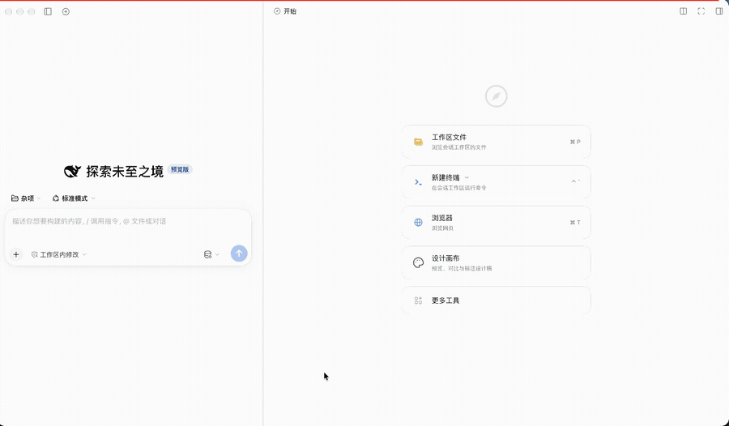
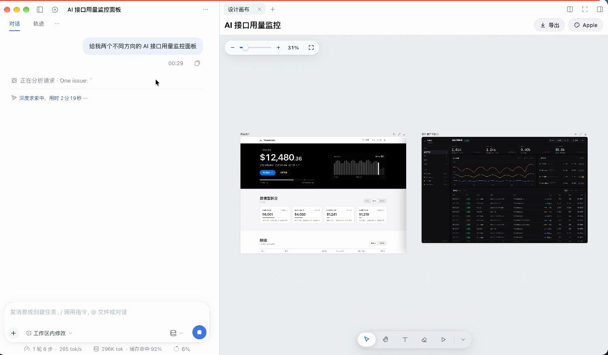
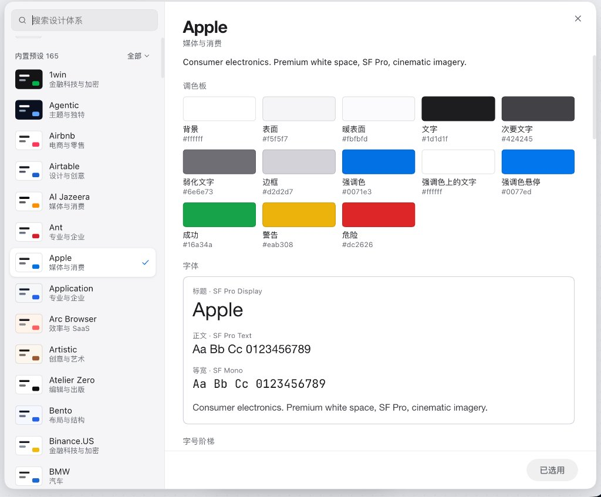
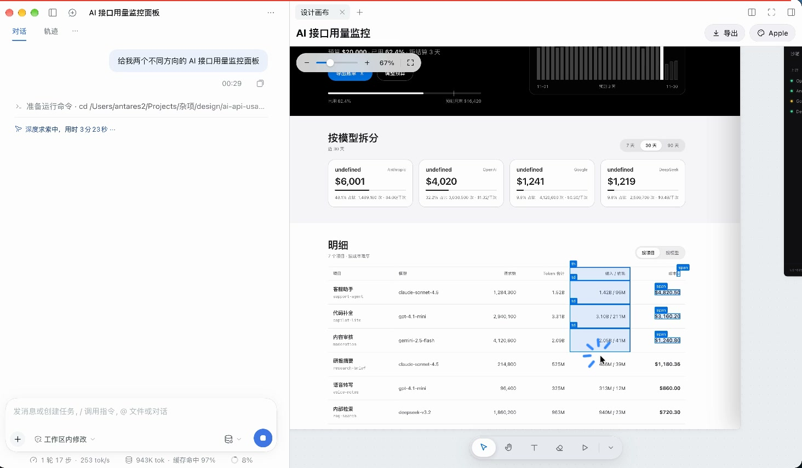

# dsh-design-board

[](https://github.com/Antares422/dsh-design-board/actions/workflows/ci.yml)
[](LICENSE)
[](https://github.com/deepseek-ai/deepseek-harness)

[English](README.md) | [中文](README.zh.md)

**Turn [DeepSeek Harness (DSH)](https://github.com/deepseek-ai/deepseek-harness) into a Figma-like interactive design canvas.**

Compare multiple agent-generated HTML prototypes side by side in the right sidebar, inspect or marquee-select DOM elements, draw annotations that feed straight back to the agent, and style pages with **165 built-in design system presets** (Apple style by default).



---

## Highlights

- **Side-by-Side Infinite Canvas**: Powered by `@xyflow/react` with Apple-style frosted glass floating dock, sliding segmented tool switcher, continuous zoom slider (`←` / `→` keyboard zoom supported), and immersive full-screen preview.
- **Direct Visual Feedback Loop**: Click or marquee-select DOM elements inside any frame or drop text notes directly on the canvas. Exact CSS selectors, text snippets, and annotations are injected silently as `<design-feedback>` before the next agent step — zero screenshot pasting.
- **165 Built-in Design System Presets**: Search, filter by category, and visually inspect 165 curated design systems (Apple, Linear, Airbnb, Stripe, Notion, Vercel, etc.) with real palettes, typography ramps, spacing/radius tokens, and preview pages. Defaults to **Apple** style when no preset is chosen.
- **Live Interactive Play Mode & Light/Dark Toggle**: Switch between element-picking mode and live interactive mode (`Play`), or toggle every frame between light and dark themes in one click.
- **Automatic Quality Gate (`<design-check>`)**: Validates real interactivity, light/dark themes, self-contained assets, and runtime errors; failing frames stay smoothly in a refining state while notifying the agent silently to fix in place.
- **Anti-AI-Slop Default Skill**: Built-in design instructions forbid patronizing helper copy, parenthetical filler, gratuitous neon/glow/card-stripe clutter, and vertical text layouts.
- **One-Click Export**: Export single frames or the entire board to PNG, multi-page PDF, or a standalone HTML gallery.

---

## Screenshots

### Side-by-Side Design Comparison


### 165 Built-in Design Systems


### Visual DOM Element Picking & Marquee Selection


---

## Quick Install

### Option 1: Ask DSH to install it directly (easiest)

Paste this message straight into your DeepSeek Harness chat:

```text
Install this plugin for me: https://github.com/Antares422/dsh-design-board
```

### Option 2: Install via DSH CLI

```bash
dsh plugin --profile web add "github:Antares422/dsh-design-board"
```

Or clone locally and add the directory:

```bash
git clone https://github.com/Antares422/dsh-design-board.git
dsh plugin --profile web add /absolute/path/to/dsh-design-board
```

In DSH Desktop / Web UI, you can also open **Plugins -> Add plugin** and select either the GitHub repository or the cloned folder.

> Prebuilt `index.js` and `client.js` are committed in the repository and attached to GitHub Releases, so no build step is needed to install.

---

## Usage

Just ask the agent naturally — no need to mention the canvas:

- *"Give me two different visual directions for an AI API usage dashboard."*
- *"Design a minimalist Pomodoro timer page."*
- Pick elements or add annotations on the canvas, then simply say: *"Update based on my selections and notes."*
- Pick any of the 165 presets from the top-right **Design System** button, then say: *"Create another direction using the selected style."*

---

## Security & Privacy

- **100% Local-Only**: All board rendering, element picking, preset lookups, and exports run locally inside your DSH instance.
- **Zero Telemetry / Zero External Requests**: No analytics, no remote accounts, no data sent to third-party servers.
- **Fully Auditable**: Source code lives under `src/` and `skills/`, tested by 136 unit tests in CI; you can rebuild `client.js` and `index.js` anytime via `npm run build`.

---

## Architecture

| Part | Entry | Responsibility |
| --- | --- | --- |
| Host plugin (Node / Cordis) | `index.js` (`src/host.js`) | Registers `/dsh-design-board/context` & `/dsh-design-board/binding` routes, injects hidden context on `agent/pre-step`, registers `design-board` & `design-board-apple-style` skills, and exposes the `design_preset` tool. |
| Client plugin (Browser) | `client.js` (`src/index.jsx`) | Registers the `design-board` tab in `ctx.sidebarRightTabs`, mounts `<Board />` into `sidebar.right.pane.tab`, and syncs session bindings & visual feedback to the host. |
| Bundle patch | `cordis.patch.yml` | Inserts the `design-board` plugin row into the DSH profile composition. |

---

## Development

```bash
npm install
npm run build   # Rebuild client.js and index.js via esbuild
npm test        # Run all 136 Node built-in unit tests
```

---

## License

MIT License — see [LICENSE](LICENSE).
