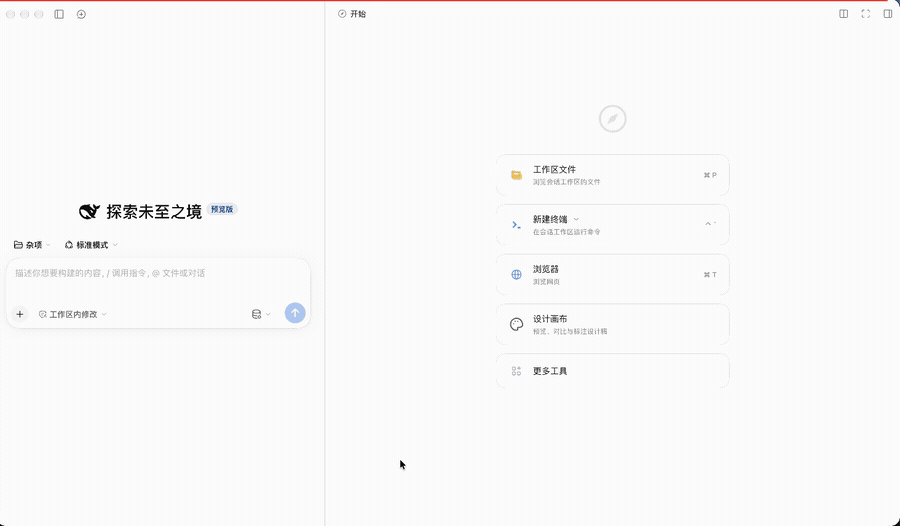
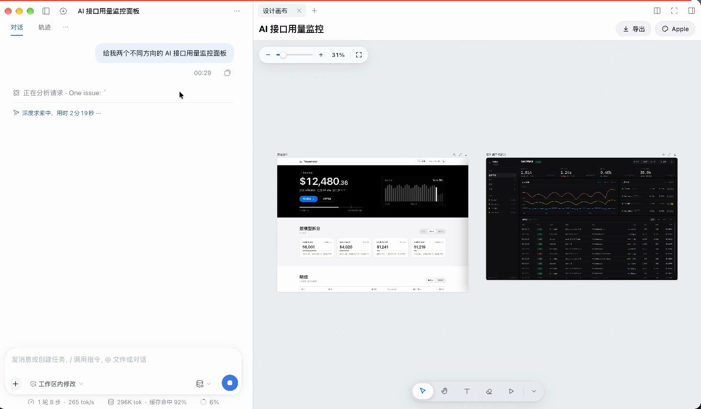
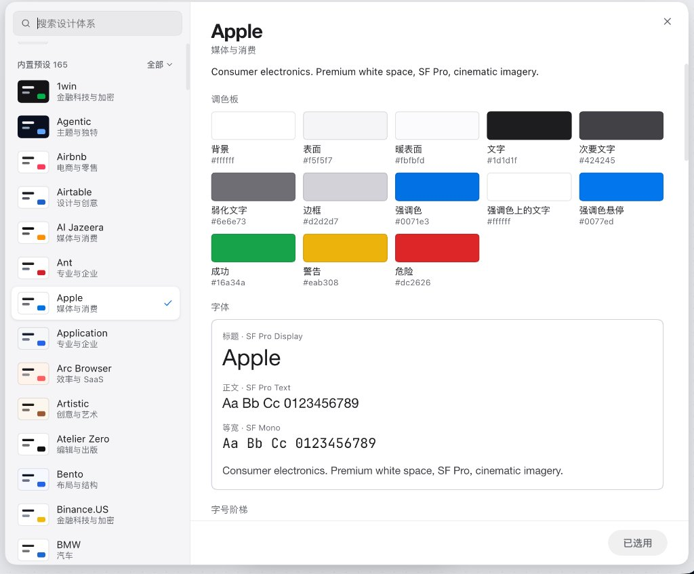
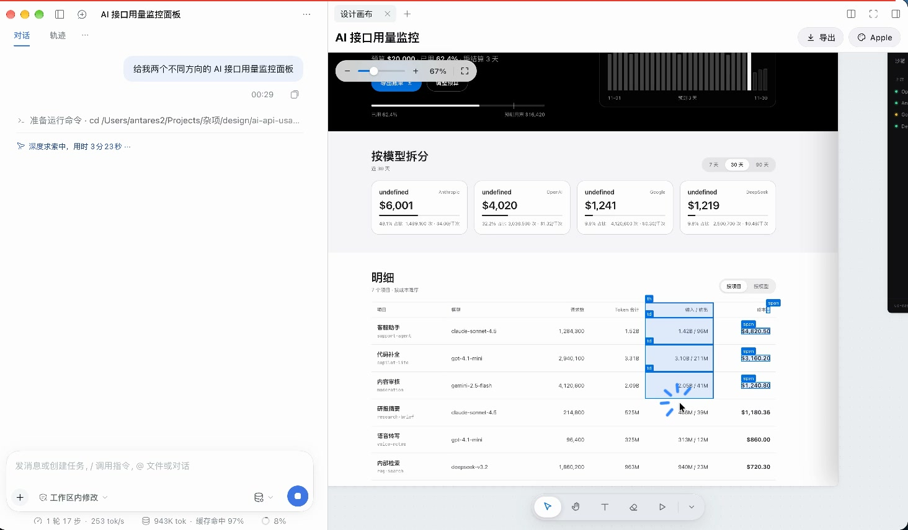

# dsh-design-board（设计画布）

[](https://github.com/Antares422/dsh-design-board/actions/workflows/ci.yml)
[](LICENSE)
[](https://github.com/deepseek-ai/deepseek-harness)

[English](README.md) | 中文

**把 [DeepSeek Harness (DSH)](https://github.com/deepseek-ai/deepseek-harness) 右侧栏变成类 Figma 的交互式设计画布。**

在右侧画布并排预览 Agent 产出的多份交互式 HTML 设计稿，直接点选或框选页面 DOM 元素、添加文字标注并自动回传给 Agent 原地改稿；内置 **165 套精选设计体系预设**（默认采用 Apple 设计规范）。



---

## 核心特性

- **多帧无限画布与原生 Apple 交互**：基于 `@xyflow/react`，配备单层毛玻璃悬浮工具栏、丝滑滑动分段胶囊、连续缩放滑块（支持键盘 `←` / `→` 缩放）与全屏沉浸查看。
- **所见即所得的元素指认与标注回传**：在画布帧内直接点选或拖拽框选 DOM 元素，或添加文字批注；精准 CSS 选择器与标注会在下一轮对话前以隐藏 `<design-feedback>` 自动注入给 Agent，告别截图标注和反复描述「左上角第二个按钮」。
- **内置 165 套设计体系预设（默认 Apple 规范）**：内置 Apple、Linear、Airbnb、Stripe、Notion、Vercel 等 165 套设计体系，支持搜索、分类筛选、调色板/字体阶梯/圆角间距/完整参考页实时预览；未指定风格时默认启用 Apple 设计规范。
- **实时交互模式与深浅主题一键切换**：随时切入 `Play` 交互模式真实点击和测试页面控件，一键切换浅色 / 深色主题。
- **自动质量门禁（`<design-check>`）**：自动校验真实交互、深浅双主题、资源自包含与运行时报错；修复期间原位平滑保持「正在优化」加载态，静默通知 Agent 原地修好。
- **内置克制审美规范（拒绝 AI Slop）**：默认设计 Skill 严禁爹味灰字提示、中英文括号凑字数、卡片左侧彩色粗边框/滥用渐变/emoji 以及竖排文字，也严禁模型私自拉起浏览器截图。
- **一键导出**：支持单帧或整页导出为高清 PNG、多页 PDF 或单文件 HTML 画廊。

---

## 实机截图

### 双方案并排对比


### 内置 165 套设计体系


### 画布内直接点选与框选 DOM 元素


---

## 快速安装

### 方式一：直接丢给 DSH 一句话安装（最省事）

直接在 DeepSeek Harness 对话框里发送：

```text
帮我安装这个插件：https://github.com/Antares422/dsh-design-board
```

### 方式二：通过 DSH CLI 安装

```bash
dsh plugin --profile web add "github:Antares422/dsh-design-board"
```

或本地克隆后安装目录：

```bash
git clone https://github.com/Antares422/dsh-design-board.git
dsh plugin --profile web add /绝对路径/dsh-design-board
```

也可在 DSH 桌面端 / Web 的 **插件（Plugins） → 添加插件（Add plugin）** 中直接选择 GitHub 仓库或本地克隆目录。

> 仓库已提交预构建的 `index.js` 与 `client.js`（同时附带在 GitHub Release 压缩包中），安装后开箱即用，无需手动构建。

---

## 使用示例

直接正常对话即可，无需刻意提「打开画布」：

- 「给我两个不同方向的 AI 接口用量监控面板」
- 「设计一个极简专注计时器页面」
- 在画布中点选/框选元素或添加标注后，直接发：「按我圈的改一下」
- 点右上角「设计体系」选定任意风格后，发：「按我选的风格再出一版」

---

## 安全与隐私说明

- **100% 纯本地运行**：画布渲染、元素捕获、预设读取与图片/PDF 导出均在本机 DSH 实例内完成。
- **零遥测、零外部上报**：不依赖任何第三方账号或云服务，不向任何外部服务器上报数据。
- **源码完全透明可验证**：全部源码位于 `src/` 与 `skills/`，CI 自动运行全部 136 项单元测试，随时可自行执行 `npm run build` 校验产物。

---

## 架构概览

| 组成部分 | 入口文件 | 职责说明 |
| --- | --- | --- |
| 宿主端（Node / Cordis） | `index.js`（源码 `src/host.js`） | 注册 `/dsh-design-board/context` 与 `/dsh-design-board/binding` 路由；在 `agent/pre-step` 注入隐藏上下文；注册 `design-board` 与 `design-board-apple-style` 技能及 `design_preset` 工具。 |
| 浏览器端（Client） | `client.js`（源码 `src/index.jsx`） | 向 `ctx.sidebarRightTabs` 注册 `design-board` 标签页，在 `sidebar.right.pane.tab` 挂载 `<Board />`，负责会话目录锁定与标注反馈同步。 |
| 组合补丁 | `cordis.patch.yml` | 将 `design-board` 条目插入当前 DSH Profile。 |

---

## 本地开发与测试

```bash
npm install
npm run build   # 使用 esbuild 重新构建 client.js 与 index.js
npm test        # 运行全部 136 项单元测试
```

---

## 开源协议

本项目基于 [MIT License](LICENSE) 开源。
